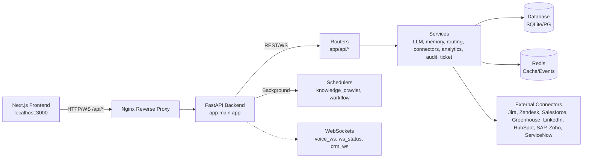
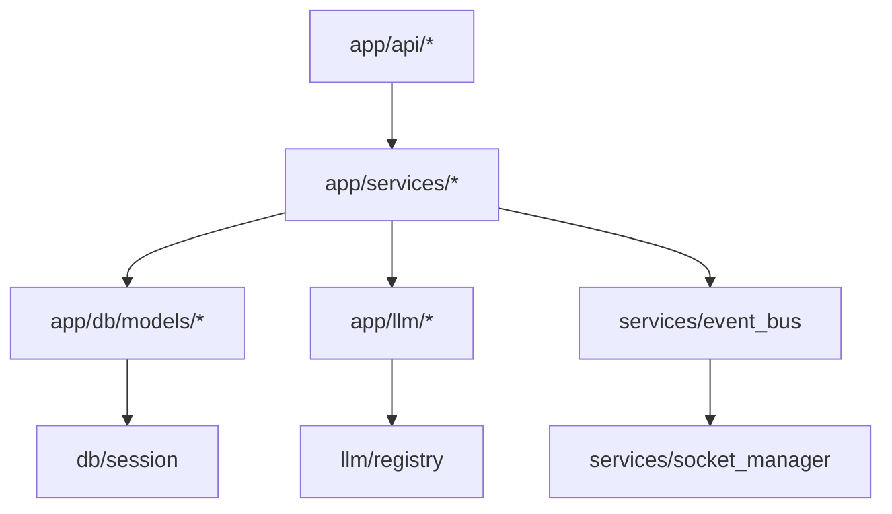
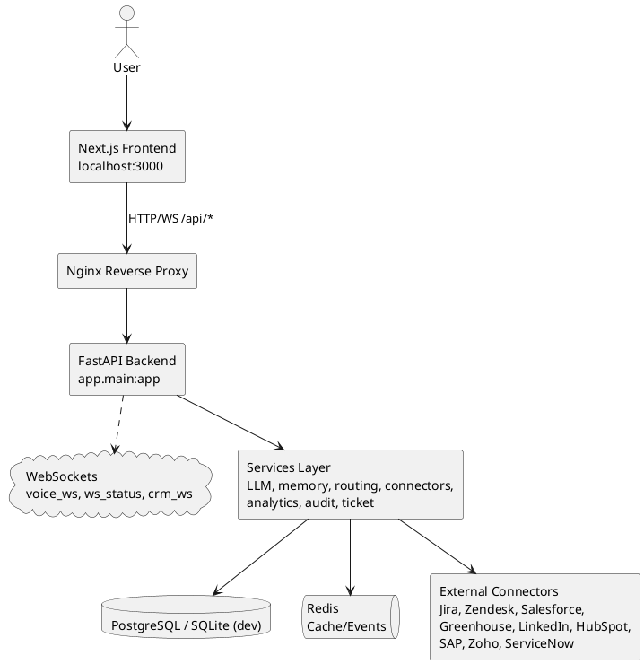

# HUEMN.Ai Architecture Diagram

This document provides a high-level view of the system architecture and module relationships. It complements the overview in the root README.

## System Architecture



### Key Links
- Backend entry: [main.py](file:///c:/Users/srava/huemn/ai/backend/app/main.py)
- Backend config: [config.py](file:///c:/Users/srava/huemn/ai/backend/app/core/config.py)
- Docker Compose: [docker-compose.yml](file:///c:/Users/srava/huemn/docker-compose.yml)
- K8s Backend: [backend.yaml](file:///c:/Users/srava/huemn/deploy/k8s/backend.yaml)
- K8s Frontend: [frontend.yaml](file:///c:/Users/srava/huemn/deploy/k8s/frontend.yaml)

## Module Map



### Notes
- Dev ports: backend http://127.0.0.1:8001, frontend http://localhost:3000
- Docker/K8s backend serves on 8000 behind Nginx; frontend is proxied via Nginx

## PlantUML

- Source file: [ARCHITECTURE.puml](file:///c:/Users/srava/huemn/ai/ARCHITECTURE.puml)
- Diagrams included:
  - SystemArchitecture
  - ModuleMap


*** End Patch*** }``` ?>>
